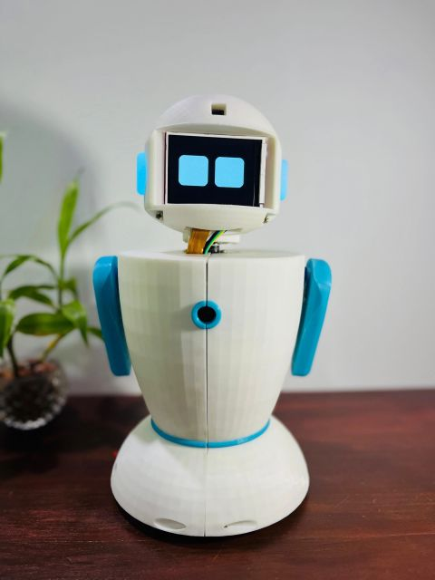
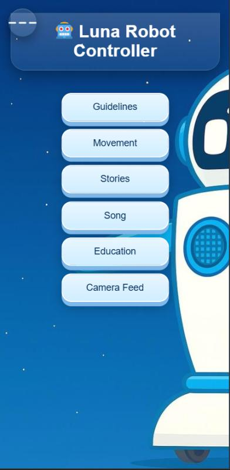

# Luna Robot

Luna is a Raspberry Pi powered companion robot with expressive eyes, voice interaction, movement, touch reactions, audio playback, and a browser based control panel. The project combines Python hardware controllers with a Flask web API and a mobile friendly interface.

  

## What Luna can do

- Listen for the **“Hey Luna”** wake word and accept voice commands through Picovoice Porcupine and Rhino.
- Drive forward, backward, left, right, or stop through the web panel or voice control.
- Animate an ILI9341 display with neutral, happy, sad, angry, love, and excited expressions.
- Move the hands and neck through a PCA9685 servo controller.
- Show mood and playback states through an RGB LED.
- React to a touch sensor with a love animation.
- Play numbered stories and songs, plus educational audio for the alphabet, numbers, and animals.
- Stream the Raspberry Pi camera as an MJPEG feed.
- Detect facial emotion through the configured Google vision endpoint and select a response.

## Web interface

The Flask server serves the control page on port `9000`. The interface provides tabs for guidelines, movement, stories, songs, education, and the camera feed.

  

Both the robot and the phone or computer opening the page must be connected to the same network.

~~~text
http://<raspberry-pi-ip>:9000
~~~

## Project layout

~~~text
.
├── main.py                       # Hardware initialization and application entry point
├── web_api.py                    # Flask routes and camera streaming
├── config.py                     # Paths, timings, GPIO-related settings, and API keys
├── command_handler.py            # Voice and web command dispatch
├── voice_controller.py           # Picovoice wake word and command recognition
├── display.py                    # ILI9341 animated eyes
├── gearNewFunction.py            # DC motor driver
├── servoNewFunction.py           # PCA9685 servo driver
├── led_emotions.py               # RGB LED moods
├── touch_sensor.py               # Touch-triggered reactions
├── media/
│   ├── stories/                  # Story audio
│   ├── songs/                    # Song audio
│   └── education/                # Alphabet, numbers, and animal audio
├── feedback/                     # Spoken status and error prompts
├── images/animals/               # Animal images for the education mode
├── luna/robot-site-2/            # HTML, CSS, JavaScript, and web background
├── lib/raspberry-pi/             # Picovoice Rhino model and native library
└── docs/assets/                  # README screenshots
~~~

## Hardware

The code is written for Raspberry Pi hardware and expects:

- Raspberry Pi with GPIO, SPI, and I2C enabled
- ILI9341 SPI display
- PCA9685 I2C PWM board with three servos
- Two-channel motor driver and two DC motors
- RGB LED
- Digital touch sensor
- Raspberry Pi camera supported by `libcamera-vid`
- USB microphone and audio output

GPIO assignments currently defined in the source are:

| Component | BCM GPIO or channel |
| --- | --- |
| Motor A direction | 24, 23 |
| Motor A PWM enable | 25 |
| Motor B direction | 17, 27 |
| Motor B PWM enable | 22 |
| RGB LED | 7, 9, 16 |
| Touch sensor | 4 |
| Servo left hand | PCA9685 channel 0 |
| Servo right hand | PCA9685 channel 1 |
| Servo neck | PCA9685 channel 2 |
| ILI9341 display | `board.D5`, `board.D6`, `board.D13` |

Check the wiring and motor driver polarity before powering the robot. The GPIO numbers are BCM numbers, not physical header pin numbers.

## Software requirements

Use Raspberry Pi OS with Python 3.9 or newer. The project imports these Python packages:

- Flask
- Pygame
- NumPy
- Requests
- Pillow
- `sounddevice`
- Picovoice `pvporcupine` and `pvrhino`
- `RPi.GPIO`
- Adafruit Blinka, RGB display, and PCA9685 libraries
- `board`, `busio`, and `digitalio`

The operating system also needs PortAudio for the microphone and the Raspberry Pi camera tools (`libcamera-vid` and `libcamera-jpeg`). Package names can vary by Raspberry Pi OS release.

## Installation

### 1. Clone the project

~~~bash
git clone <repository-url>
cd Luna-Code-Base
~~~

### 2. Install system packages

~~~bash
sudo apt update
sudo apt install -y python3-venv python3-pip python3-dev \
  portaudio19-dev libcamera-apps
~~~

If the Adafruit or GPIO libraries are not available in the system Python, install their current Raspberry Pi compatible releases with `pip`.

### 3. Create an environment and install Python packages

~~~bash
python3 -m venv .venv --system-site-packages
source .venv/bin/activate

pip install Flask pygame numpy requests pillow sounddevice \
  pvporcupine pvrhino RPi.GPIO adafruit-blinka \
  adafruit-circuitpython-rgb-display adafruit-circuitpython-pca9685
~~~

Some Raspberry Pi images provide `RPi.GPIO`, `board`, and `digitalio` through apt packages instead. Use one package source consistently when possible.

### 4. Configure credentials and hardware

Edit [`config.py`](config.py) and set:

- `PICOVOICE_ACCESS_KEY` for the Porcupine wake word and Rhino command model.
- `GOOGLE_API_KEY` for facial emotion detection.
- Any timing or media paths that differ on your installation.

The repository currently contains credential values in `config.py`. Rotate any exposed keys and move them to a protected configuration method before sharing or deploying the project. Do not commit new keys.

The wake word file, Rhino context, model, and native library are expected at the paths already listed in `config.py`:

~~~text
hey-luna_en_raspberry-pi_v3_0_0.ppn
robot_commands_en_raspberry-pi_v3_0_0.rhn
lib/raspberry-pi/rhino_params.pv
lib/raspberry-pi/arm11/libpv_rhino.so
~~~

### 5. Start Luna

~~~bash
source .venv/bin/activate
python main.py
~~~

At startup the program initializes the display, LEDs, servos, motors, audio, touch listener, web server, and voice listener. The web server listens on:

~~~text
http://0.0.0.0:9000
~~~

Open `http://<raspberry-pi-ip>:9000` from a device on the same Wi-Fi network.

`start_luna_robot.sh` is an optional boot script, but it contains deployment-specific paths under `/home/tharu/`. Update the virtual environment and project paths before using it on another Raspberry Pi.

## Web API

The browser interface calls these endpoints:

| Route | Method | Purpose |
| --- | --- | --- |
| `/move` | `POST` | Move with `forward`, `backward`, `left`, `right`, or `stop` |
| `/volume` | `POST` | Increase or decrease audio volume |
| `/play` | `POST` | Play a numbered story |
| `/story/stop` | `POST` | Stop story playback |
| `/story/next` | `POST` | Move to the next story |
| `/music` | `POST` | Play a numbered song |
| `/music/stop` | `POST` | Stop song playback |
| `/music/next` | `POST` | Move to the next song |
| `/education/play` | `POST` | Play `alphabet`, `numbers`, or `animals` |
| `/education/stop` | `POST` | Stop educational playback |
| `/education/next` | `POST` | Move to the next educational track |
| `/start` | `POST` | Prepare the camera stream |
| `/stop` | `POST` | Stop the camera process |
| `/video_feed` | `GET` | Return the MJPEG camera stream |

Example request:

~~~bash
curl -X POST http://<raspberry-pi-ip>:9000/move \
  -d "direction=forward"
~~~

## Voice control

Say **“Hey Luna”** and then issue a command during the listening window. Supported command groups include:

- Navigation and movement
- Volume up or down
- Play a specific story or song
- Play a random story, song, or educational category
- Stop or skip playback
- Sleep and wake
- Emotion detection

The exact recognized phrases are defined by the Picovoice Rhino context file in the repository.

## Troubleshooting

- **No USB microphone found:** connect a USB microphone and confirm it appears in `sounddevice.query_devices()`.
- **Camera feed or emotion detection fails:** verify the camera is enabled and both `libcamera-vid` and `libcamera-jpeg` work from the shell.
- **Web page does not load:** confirm `main.py` is running and that port `9000` is reachable from the client device.
- **Import or GPIO errors:** activate the virtual environment and install the Raspberry Pi and Adafruit dependencies for the same Python interpreter that runs `main.py`.
- **Motors or servos move incorrectly:** power motors and servos from an appropriate supply, share the ground with the Pi, and verify the BCM wiring table above.

## License

No license file is included yet. Add a license before distributing the project.
